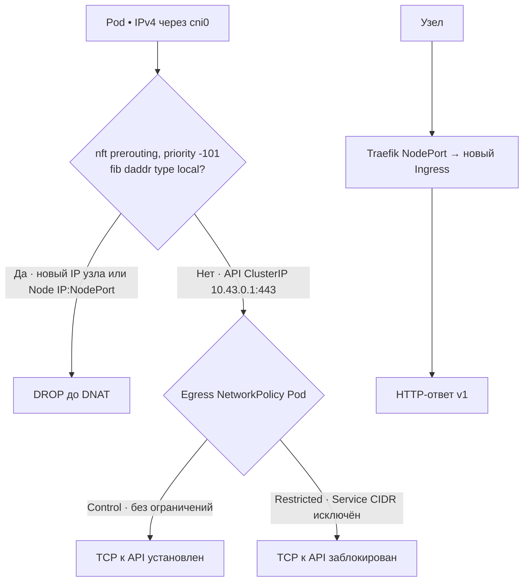

# Предложение: устойчивая граница Pod/host для `all`

**8 ноября владелец одобрил реализацию и проверку на выделенной network-check для одностекового IPv4.** На одноразовой VM после смены адреса узла Pod с разрешённым внешним egress подключился к новому адресу host до изменения NetworkPolicy. [Условия и измерения](component-network-node-check-2026-11-08.md). Периодическая сверка IP-исключений имеет окно, поэтому сама по себе не удовлетворяет согласованному условию `all`.

Предлагается рассмотреть отдельное постоянное ограничение на узле для поддерживаемого однодового профиля k3s/flannel, независимо от списка адресов в NetworkPolicy:

1. Installer устанавливает выделенную собственную таблицу nftables с правилом для трафика из подтверждённого Pod-интерфейса к **любому локальному адресу узла**, определяемому ядром в момент обработки пакета. Проверку назначения необходимо выполнять до NodePort DNAT; отдельно проверить путь INPUT и маршрутизацию. Ответы на соединения, инициированные узлом, сохраняются за счёт conntrack. Общие таблицы, чужие правила и CNI installer не меняет.
2. Правило должно применяться после каждой загрузки до допуска workload и `all`. Installer проверяет точный набор правил, расположение hook и priority, kernel/bridge netfilter, Pod interface и CIDR, семейства IP, маршрутную таблицу, а также собственные service/unit и их состояние. Если хоть один параметр не подтверждён, `all` закрывается. IPv6 допускается только после отдельной проверки эквивалентной границы; неподдерживаемое семейство не считается защищённым.
3. При изменении интерфейса, CNI, маршрута, адресов, правил, перезагрузке или недоступности наблюдения подтверждение профиля становится недействительным. До повторной проверки исполнитель снимает собственное расширяющее правило каждого затронутого компонента по подтверждённому UID, фиксирует BLOCKED и не запускает новые Pod. Изменения профиля, находящиеся под управлением PaaS, сначала закрывают допуск; сторонний доверенный writer должен соблюдать тот же порядок. Одного периодического опроса недостаточно для гарантии отсутствия окна при произвольном внешнем изменении.
4. После подтверждения этой границы NetworkPolicy `all` допускает исходящий трафик конкретного instance, исключая специальные диапазоны, внутренние маршруты и инфраструктурные адреса всех поддерживаемых семейств. Отдельные DNS, PostgreSQL и Service разрешения остаются по своим полномочиям. Смена revision или instance отменяет прежнее подтверждение; подтверждение APPLIED возможно только после чтения обеих политик и проверки актуального профиля.

На network-check прошла проверка IPv4-цепочки `prerouting` с приоритетом `-101`. Для трафика с `cni0` ядро определяет локальное назначение через `fib daddr type local`. Привязка фильтра к source IP позволяла контейнеру с `CAP_NET_RAW` обойти его подменой адреса отправителя. В испытанной версии условие по source IP удалено. После холодной загрузки Pod не достиг нового адреса ноды, разрешённый peer остался доступен. После пересоздания CoreDNS и Traefik новый Service разрешился по DNS, а новый Ingress ответил по HTTP. Для штатного профиля ещё требуется проверить эту границу через установщик и политику PaaS для приложения и мигратора. [Подробный протокол](component-network-node-check-2026-11-08.md).

Схема показывает новые TCP-соединения на одноузловом IPv4-стенде. Для API ClusterIP указаны результаты двух Pod с разными политиками egress.

Одобрена одна собственная таблица nftables и один systemd unit PaaS. При управляемом изменении CNI или маршрутизации сначала закрывается `all`. При включённом IPv6 или неподтверждённом сетевом профиле `all` остаётся BLOCKED. Приёмка включает добавление нового адреса после активации правила и перезагрузку ноды.

На тестовой VM при неверном nft-файле `Requires` блокировал старт **всего k3s**, а вместе с ним БД, daemon и UDS, а не только `all`. Это существенное последствие для оператора. Жёсткую зависимость нельзя включать на существующей ноде до явного выбора поддерживаемого профиля и проверки его совместимости. Для выбранного профиля заранее нужен проверенный root-путь восстановления: определить ошибку guard unit через `systemctl status`/`journalctl`, восстановить проверенный ранее файл правил и состояние установщика, выполнить `nft --check`, запустить guard и только затем k3s; нельзя удалять правило и запускать workload с прежним разрешением `all`. Отказ и восстановление, включая reboot после восстановления, входят в приёмочные тесты. [Наблюдение на VM](component-network-node-check-2026-11-08.md#эксперимент-с-одобренной-nftables-границей).

Владелец выбрал поведение при одновременной потере связи с узловой проверкой и control plane. Приложение сохраняет последнее фактически применённое правило до восстановления. Защита локальных адресов продолжает работать на ноде. Новые допуски закрыты, актуальность прежней ревизии остаётся неподтверждённой. Управляемое изменение CNI или маршрутов ждёт подтверждённого отзыва. После восстановления исполнитель сверяет профиль и правила по UID перед публикацией актуальной ревизии.

### Как daemon проверяет снимок узла

Владелец одобрил отдельный каталог `/run/paas/network-proof`. Узловой процесс
атомарно заменяет `snapshot.json`. Daemon получает только этот каталог, в режиме
read-only. Монтируется каталог целиком, чтобы новое имя после rename указывало на
актуальный файл. В снимке нет паролей, ключей или средств управления firewall.

Исполнитель сверяет boot ID с текущей загрузкой и UID ноды с
`PAAS_NETWORK_NODE_UID`, полученным при установке. Он проверяет ID установки,
состояние PROVEN, срок действия, ревизию профиля и исключённые IPv4-сети.
После смены загрузки или профиля новое поколение снимка требует повторной
проверки допуска. Этот контракт применяется перед выдачей нового all и перед
подтверждением исполнения. Приёмка полного пути от узлового процесса до
Kubernetes policy остаётся открытой.

### Доступ metrics-server к kubelet

С экспериментальным правилом metrics-server терял доступ к kubelet на TCP
10250. Metrics API возвращал 503. После снятия таблицы тот же Pod возобновил
сбор метрик. [Сравнение на network-check](component-network-node-check-2026-11-08.md).

Для проверки предложено определить host-veth metrics-server по UID Pod,
цепочке владельцев и работающему sandbox. В цепочке bridge метка очищается у
входящего трафика Pod и выставляется только на проверенном интерфейсе. В inet
исключение ограничивается этой меткой, адресом ноды и TCP 10250. Нужны проверки
с подменой source IP и метки из другого Pod, пересоздания metrics-server и
переиспользования его адреса, а также повтор `kubectl top nodes`. Владелец
одобрил эксперимент с дополнительной таблицей bridge на network-check и
включение в штатный профиль после успешных проверок.
