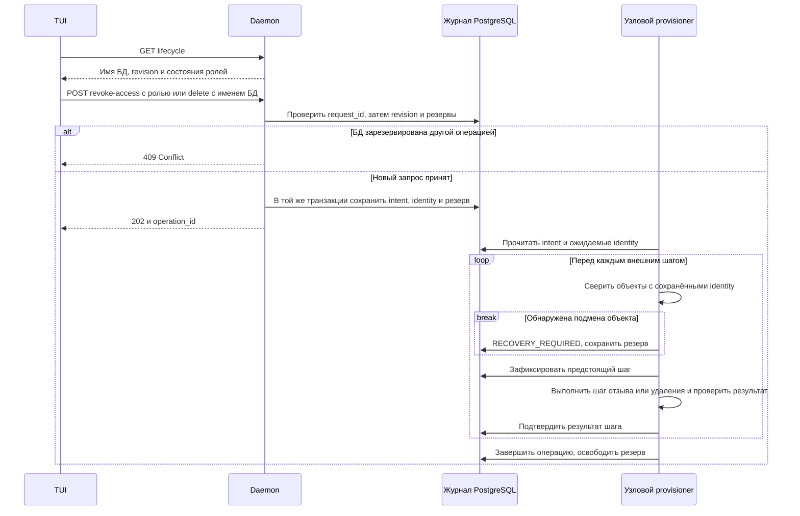

# Отзыв SQL-доступа и удаление прикладной БД в v1

Пользователь подтвердил включение обеих операций в однодовую v1 и поручил подготовить контракт. 8 ноября пользователь одобрил контракт и реализацию для v1. Для приёмки используются только новые одноразовые приложения.

## Что увидит оператор

На экране приложения действие «Управление БД» показывает app_id, имя прикладной БД, состояние и разрешённые действия. «Отозвать SQL-доступ» требует явно выбрать APPLICATION или MIGRATOR. Перед подтверждением TUI указывает, какой LOGIN утратит доступ, что его активные сессии будут завершены и что данные сохранятся. Вторая роль продолжит работать. Отзыв MIGRATOR блокирует новые миграции. Для APPLICATION управляемый workload может потерять готовность из-за отказа подключения; PaaS не масштабирует его автоматически.

Действие «Удалить БД» показывает имя БД, приложение и полный состав удаления: данные и история Goose этой БД, три выделенные роли (включая NOLOGIN-владельца), оба прикладных Secrets. Оператор вводит показанное имя БД и подтверждает удаление. Незавершённые транзакции её клиентских сессий откатятся. Архив данных или восстановление из backup в эту команду не входят. Каталог приложения, компоненты, домены, чужие БД и публичная история операций сохраняются. Обе команды используют обычный административный вход SSH/UDS.

## Предлагаемые маршруты Flux

| Запрос | Тело или параметры | Результат |
| --- | --- | --- |
| GET /apps/database/lifecycle | query: app_id | 200: app_id, database_name, revision, database_state, application_access, migrator_access, необязательный active_operation_id. Для сохранённой записи DELETED — тот же ответ с конечным состоянием. |
| POST /apps/database/revoke-access | app_id, expected_revision, request_id, purpose (APPLICATION или MIGRATOR) | 202: ID долговечной операции при первом принятии; 200: тот же ID при повторе идентичного запроса. |
| POST /apps/database/delete | app_id, expected_revision, request_id, confirm_database_name | 202 / 200 как для отзыва. Подтверждённое имя должно буквально совпадать с именем из GET. |

Оба POST — JSON до 1 MiB. Идентификаторы и revision используют существующие правила settings; значения credentials, DSN и токены не входят ни в один DTO. Unknown app или отсутствие записи о БД дают 404. Неверное тело или подтверждённое имя — 400, слишком большое тело — 413. Конфликт содержимого с уже занятым request_id, устаревшая revision, активный деплой/подготовка/миграция с резервом БД и неподходящее исходное состояние дают 409 с типизированным кодом. Проверка повтора принятого запроса выполняется до проверки изменившейся ревизии. Сбой чтения источника истины — 503. Завершённое действие нельзя запустить ещё раз новым request_id. Старые preview, которым требуется БД или отозванная роль, проверяют ревизию до приёма и перед соответствующим внешним шагом.

Предложенные состояния БД: READY, DELETING, DELETED и RECOVERY_REQUIRED для этих операций. Состояния подготовки PENDING/RECOVERY_REQUIRED остаются доступны чтению; обе команды требуют завершённой подтверждённой подготовки. Состояния доступа каждой роли: ACTIVE, REVOKING, REVOKED; после удаления — REMOVED. Чтение карточки операции производится через существующую историю по ID с целью APP, с явным видом действия и статусом. Новые app-scoped записи имеют отдельный тип операции, отличимый от миграции; projection для legacy component-only клиентов не меняется.

Для обратной совместимости существующие GET /operations/history и /operations/inspect по умолчанию сохраняют прежнюю проекцию. Новая TUI явно передаёт необязательное `include_database_actions=true`: выбираются также APP-записи с `database_action` (REVOKE_ACCESS с purpose или DELETE). APP-запись содержит одно из двух описаний — migration либо database_action. Для нового вида без такого opt-in прямое чтение по ID даёт 404. Курсоры страниц привязаны к выбранной проекции. Прежние component-only GET продолжают обслуживать прежних клиентов. Это не требует отдельного transport URL.

## Кто и как меняет БД

Daemon в одной короткой транзакции проверяет ревизию и резервы, сохраняет intent, исходные identity, желаемое состояние и request_id. С момента принятия блокируются выдача выбранных credentials и новые зависимости от этой роли. Внешний SQL исполняет существующий доверенный узловой provisioner. Прикладному daemon не нужны DROP DATABASE, управление LOGIN и доступ к административному паролю PostgreSQL. Проверяются installation и app_id, system_identifier, OID БД и ролей, теги владельца, UID Namespace и обоих Secret. Для Secret используются именованные операции с UID-precondition.

**Отзыв.** Для выбранного LOGIN доверенный исполнитель фиксирует NOLOGIN и снимает CONNECT. Сначала он проверяет роль по OID и имени и прекращает допуск новых входов. Затем завершает сессии этой выделенной роли, проверяя идентичность роли и процессов. Успех требует отсутствия живых сессий и подтверждённого запрета нового входа. У отозванной роли reveal возвращает 409 ACCESS_REVOKED; новая привязка к отозванным credentials отклоняется. Старый пароль в уже запущенном процессе может остаться в памяти, но новая аутентификация с ним запрещена. Узловая подготовка при повторе не возвращает LOGIN. Отзыв не меняет права второй роли и не удаляет таблицы или данные.

**Удаление.** Записывается состояние DELETING. Исполнитель запрещает новые соединения к целевой БД и входы обеих ролей, завершает её клиентские сессии и проверяет неподдерживаемые препятствия, например prepared transactions. Далее удаляет только проверенную БД из отдельного административного соединения, принадлежащие ей выделенные роли и ожидаемые Secrets. Зависимости роли за границами этой БД останавливают очистку; универсальный DROP OWNED/CASCADE по другим БД запрещён. Подтверждённая запись DELETED сохраняется как защита от повторной подготовки. У приложения с сохранённым migrator.image новый deploy с миграцией после удаления получает 409 DATABASE_DELETED. Для явного нового выделения БД потребуется отдельное решение; случайный повтор старого деплоя не создаёт её снова.

Перед каждым внешним шагом сохраняются intent и проверенные идентичности, после шага — результат. Если ответ потерян, исполнитель повторно читает фактическое состояние. Объект с прежним именем и другим UID/OID останавливает операцию с RECOVERY_REQUIRED и сохранёнными резервами. Операция не должна удалять заново созданный объект. При команде DROP DATABASE имя может быть перепривязано сторонним администратором между проверкой и DDL: режим v1 требует одного доверенного административного писателя и отсутствия конкурентного ручного DDL на управляемых БД/ролях. При наблюдаемом расхождении требуется разбор владельцем.

## Приёмка после одобрения

Создать два одноразовых приложения с раздельными БД. Для отзыва проверить существующую и новую TCP-сессии каждой роли, доступ второй роли, сохранение данных и отказ reveal. Для удаления проверить подтверждение имени, запрет операции при активной миграции, сохранение соседнего приложения и его паролей, отсутствие только выбранных БД/ролей/Secret и отказ скрытому перевыделению. Для каждого внешнего этапа проверить повтор после потери ответа и безопасную остановку при подмене identity. Проверить карточки операций через TUI и стабильный ID после потерянного ответа. Для испытаний выделяются новые одноразовые данные.
