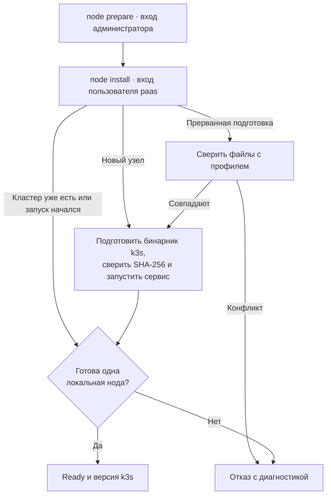
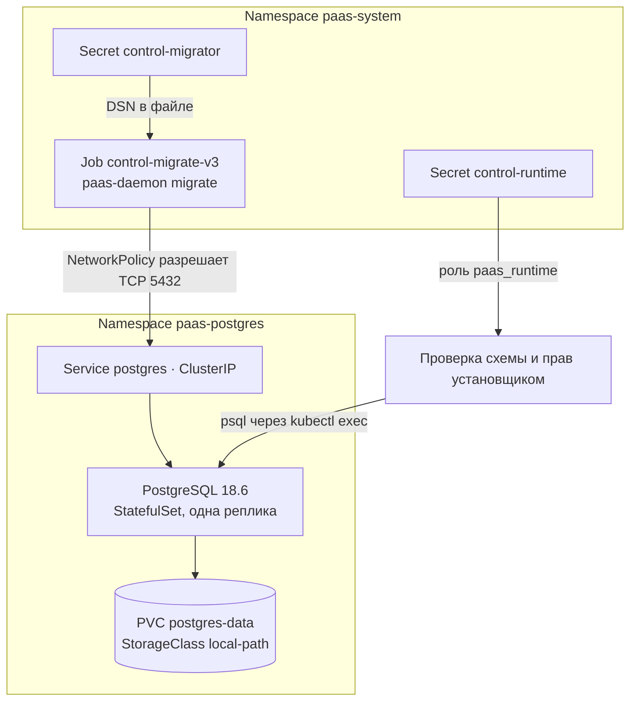
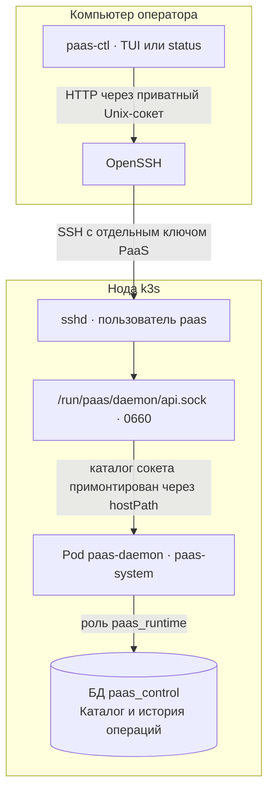
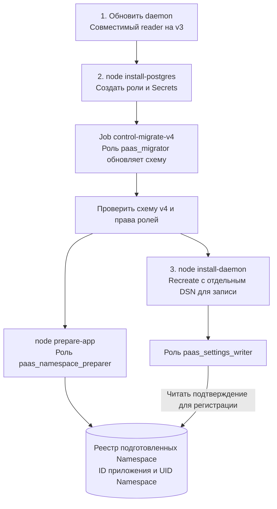
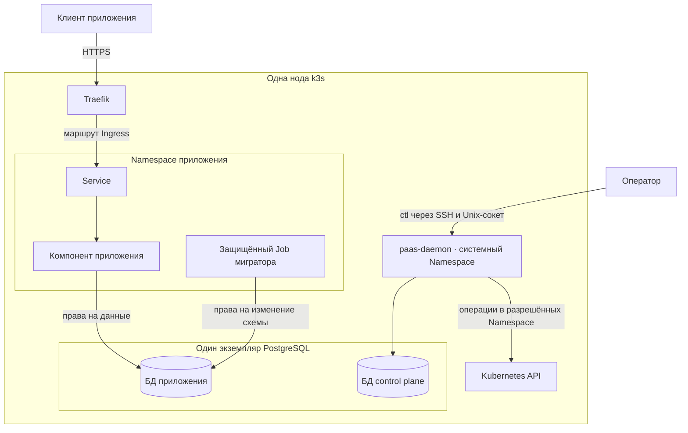
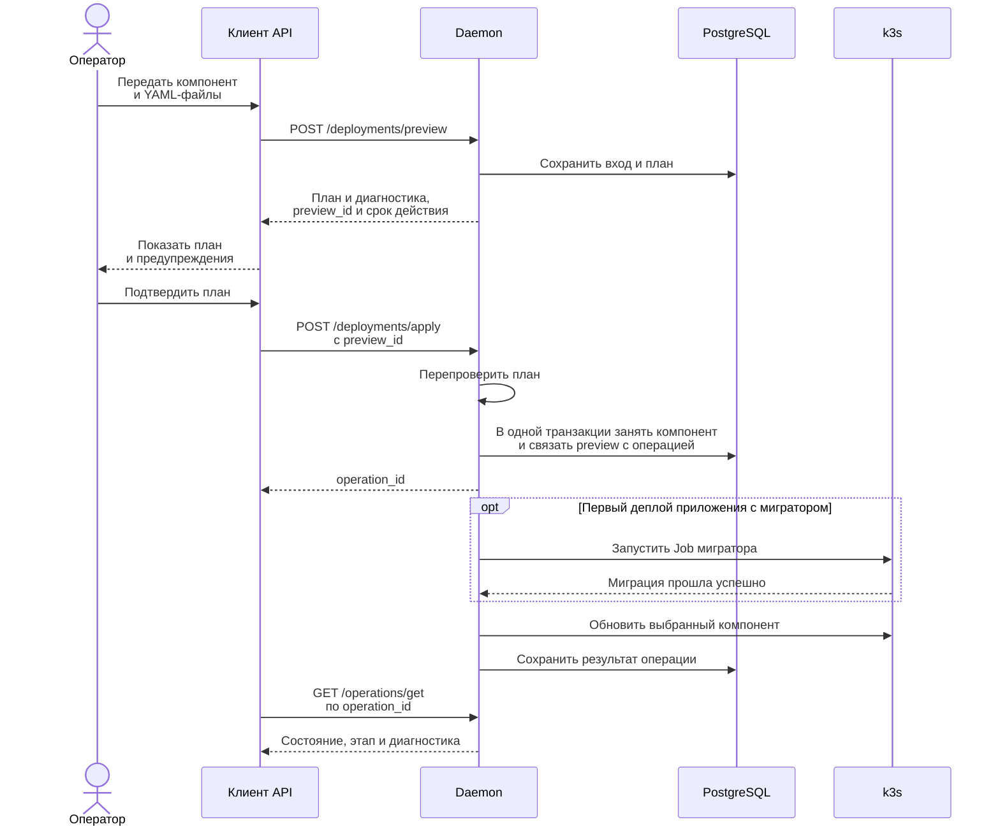

# Однонодовая PaaS

PaaS `1.x` рассчитана на одну ноду k3s. Оператор запускает `paas-ctl` без
аргументов, чтобы открыть TUI на Bubble Tea. На экране **Серверы** можно
подготовить SSH-доступ, выбрать профиль и установить k3s, PostgreSQL и постоянно
работающий Pod daemon. Каталог и история операций доступны через SSH-туннель.

В мастере установки (`i`) оператор указывает два образа по digest — для миграции
и для daemon. Образы заранее импортирует администратор. После подтверждения
(`y`) мастер выполняет `node prepare` с административным ключом, затем
`node install`, `node install-postgres` и `node install-daemon` с ключом
пользователя `paas`. При ошибке TUI показывает, какой шаг остановился.

## Как ctl устанавливает и проверяет ноду

После подготовки SSH-ключа оператор выполняет две команды. Для
`paas-ctl node prepare` нужен независимый административный вход. Команда
размещает на сервере профиль, unit systemd и установщик, которыми владеет root.
`paas-ctl node install` использует ключ пользователя `paas` и вызывает
установщик через sudo. Разрешение sudo для этой операции ограничено одним
исполняемым файлом без аргументов.

`Ready` требует локального API закреплённой версии, ровно одной Ready-ноды
с `machineID` этого сервера и включённого шифрования Kubernetes Secrets.
При повторе после попытки запуска ctl проверяет существующий кластер.
Остановленный сервис остаётся остановленным до вмешательства администратора.

Приёмка прошла на Debian 13 arm64 в виртуальной машине с настоящим
`v1.37.2+k3s1`. Проверены первая установка и повтор. После подключения
второго kubelet кластер показал две Ready-ноды. Повторный `node install`
завершился отказом и сохранил кластер. После возврата к одной ноде проверка
снова прошла. [Результаты приёмки k3s](development/k3s-node-check-2026-11-07.md).

## Как устанавливается служебная БД

На готовой ноде администратор импортирует образ мигратора в containerd и
передаёт его digest в `paas-ctl node prepare --migration-image`. Затем
`paas-ctl node install-postgres` подключается по SSH под пользователем `paas`
и через sudo запускает отдельный установщик без аргументов. Административный
kubeconfig остаётся на ноде. Установщик проверяет ноду, создаёт БД
`paas_control` и две роли, запускает Job и проверяет результат.

На схеме показан профиль v3. Job получает только DSN мигратора. После его
завершения установщик проверяет версию схемы и права чтения от имени
`paas_runtime`, затем выводит `Ready: PostgreSQL 18.6, paas_control schema v3`.

На двух Debian 13 arm64 проверены установка с нуля, сохранность данных и
паролей при повторе и изоляция от постороннего Namespace. При пересоздании
Pod PostgreSQL использовал прежний том. На отдельном стенде удалили
runtime Secret. Повторная установка потребовала его восстановления и
сохранила данные.
[Результаты приёмки PostgreSQL](development/postgres-node-check-2026-11-07.md).

## Как TUI подключается к daemon

`node install-daemon` создаёт Deployment с одной репликой и стратегией
Recreate. Daemon работает от UID/GID 61001 и открывает HTTP API на файловом
Unix-сокете. TUI и служебная команда `paas-ctl status` подключаются к нему
с правами SSH-пользователя `paas`.

Ответ `/health` даёт первую строку `status` — `API: reachable`. Для второй
строки `Control plane: ready` daemon за две секунды должен проверить соединение
с БД, версию схемы и права чтения. Если подключена роль записи настроек,
`/ready` проверяет также её права. При недоступности PostgreSQL живой daemon
возвращает 200 на `/health` и 503 на `/ready`.

В TUI клавиша Enter на экране **Серверы** открывает **Приложения**. На экране
**Приложение** доступны компоненты, а в **Операциях** (`o`) — страницы истории,
фильтр состояния и диагностика. В PTY на реальном k3s проверены установка,
переходы между экранами, отказ БД, обновление образа и подключение после
холодной загрузки ноды. [Приёмка TUI и Unix-сокета](development/tui-node-check-2026-11-07.md).

Через тот же серверный сокет клиент SDK читает приложения и компоненты по GET
маршрутам `/apps/list`, `/apps/get`, `/components/list` и `/components/get`.
`GET /operations/get?operation_id=…` возвращает сохранённый снимок операции,
а `GET /operations/list` позволяет листать историю и фильтровать её по состоянию.
На свежей БД список пуст.
[Приёмка каталога](development/storage-validation-check-2026-10-22.md) и
[чтения истории через Unix-сокет](development/operation-history-check-2026-11-07.md).

## Переход к регистрации и настройкам приложений

На действующей схеме v3 совместимый daemon продолжает читать каталог и историю.
Для добавления настроек администратор передаёт digest отдельного образа через
`node prepare --settings-migration-image`. На схеме показан порядок обновления
существующей ноды.

При переходе сохраняются PVC, каталог и завершённый `control-migrate-v3`.
Доверенный `prepare-app` резервирует ID приложения, подготавливает Namespace
и подтверждает его UID. После этого daemon может зарегистрировать приложение
по `request_id`. Роль `paas_settings_writer` записывает настройки приложения
и компонента. Роль `paas_runtime` читает каталог, историю и настройки.
Повторная регистрация с тем же ключом возвращает прежний результат. При
смене политики компонента или образа мигратора клиент передаёт ожидаемую
ревизию, чтобы обнаружить одновременную правку.

Обновление работающей ноды с v3 до v4 проверено на k3s. Отказ миграционного
Job оставил прежний каталог доступным. Повтор с тем же профилем завершил
переход и сохранил PVC, пароли и каталог. После перерыва в подготовке
Namespace повторная регистрация подтвердила прежний UID.
[Приёмка обновления на ноде](development/settings-node-upgrade-2026-11-08.md)
и [проверки SDK и хранилища](development/settings-sdk-store-check-2026-11-07.md).

## Целевое размещение в k3s

На схеме показан один из возможных наборов компонентов приложения с мигратором.
Доверенный этап установки готовит узел, Namespace и права. Daemon управляет
ресурсами в подготовленных Namespace от своего ServiceAccount.

Каждое новое приложение с мигратором получает свою БД и две отдельные роли.
При создании приложения без мигратора PaaS пропускает подготовку БД. Traefik
обслуживает внешний трафик приложений. Оператор обращается к управляющему API
через SSH. [Инфраструктура](../openspec/changes/define-k3s-paas-foundation/specs/shared-infrastructure/spec.md)
и [права в PostgreSQL](../openspec/changes/define-k3s-paas-foundation/specs/application-database-access/spec.md).

## Деплой одного компонента

Первый деплой приложения с мигратором проверен через SSH/UDS API: операция
завершилась успешно после миграционного Job и создания Deployment. Повтор
`apply` вернул прежний `operation_id`. Для ручной миграции оператор в TUI выбирает приложение, нажимает `m`,
проверяет preview и подтверждает запуск клавишей `y`. В истории операций
проверена карточка с целью APP и конечным состоянием SUCCEEDED. Схема показывает путь принятого плана.

Если план изменился, оператор запрашивает новый preview и заново подтверждает
его. Если ответ на принятый apply потерялся, повтор с тем же `preview_id`
возвращает прежний `operation_id`. Ошибка обязательной первой миграции
останавливает запуск приложения. При последующих обновлениях оператор выбирает
миграцию явно. [Приёмка первого деплоя](development/initial-database-deploy-2026-11-08.md),
[изоляция БД и конкурентные миграции](development/app-database-isolation-2026-11-08.md),
[контракт деплоя и восстановления](../openspec/changes/define-k3s-paas-foundation/specs/independent-deployments/spec.md).
